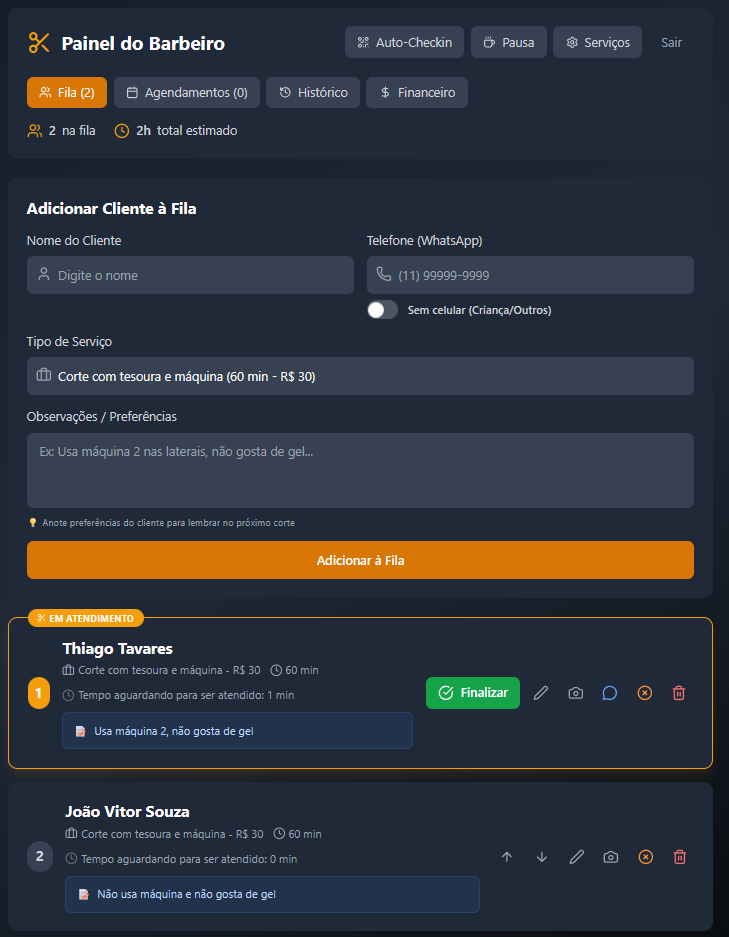
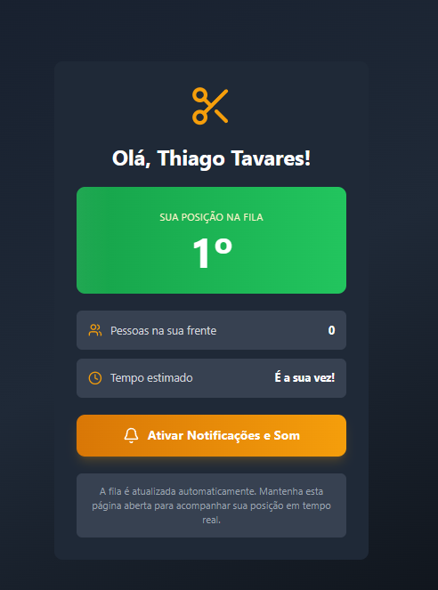
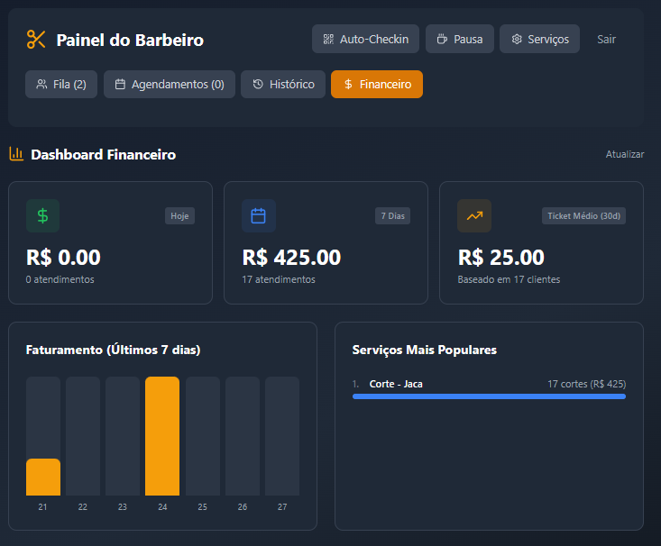
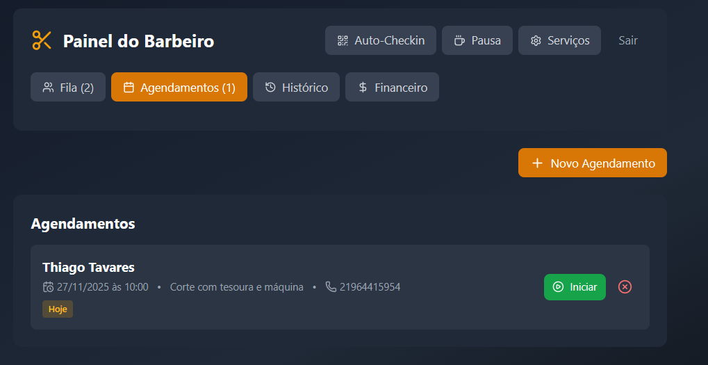
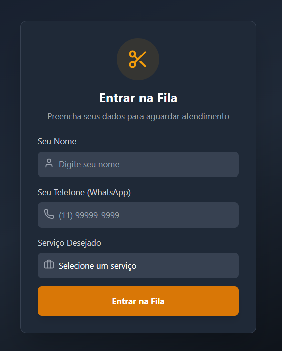
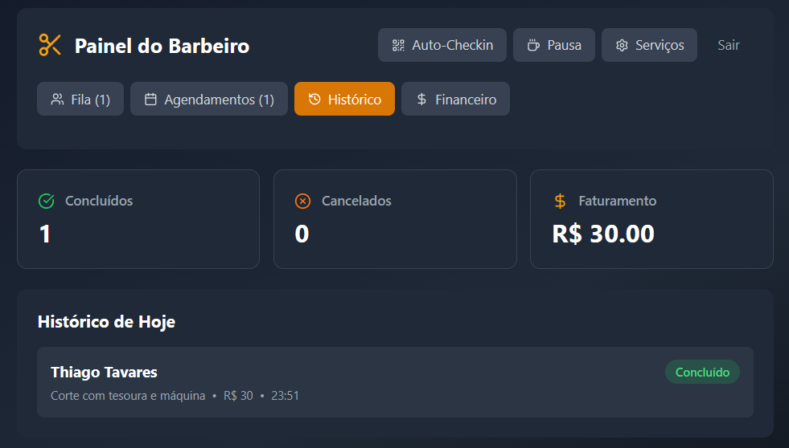

# 💈 Sistema de Gerenciamento de Fila para Barbearia

Sistema completo de gerenciamento de fila para barbearias com painel do barbeiro, visualização do cliente em tempo real, agendamentos, dashboard financeiro, temas de cores, logo da barbearia e muito mais.

## 🆕 Novidades

### Adicionado

- **Pix adiantado**: depois de entrar na fila, o cliente pode pagar o serviço que escolheu por Pix (código "Copia e Cola" ou QR Code, sempre com o **preço daquele serviço**) e enviar o comprovante. O barbeiro configura a chave nas Configurações, é avisado no painel e confere cada pagamento. Pagou e não veio? O barbeiro decide entre **devolver** ou guardar como **crédito** para o próximo atendimento. Veja [Pix adiantado](#-pix-adiantado).
- **Segurança reforçada**: novo `firestore.rules` no repositório, com a fila pública protegida contra adulteração de preço/serviço, chave secreta por cliente para o pagamento, comprovantes só para o dono, senha para mudar a chave Pix e QR Codes gerados no próprio navegador. Veja [Segurança](#-segurança).
- **Testes automatizados** do Pix, das regras do Firestore (emulador) e do fluxo completo. Veja [Testes](#-testes).
- **Aba Configurações** no painel do barbeiro, que substitui o antigo modal de Perfil: nome da barbearia, Instagram, logo e cores do site.
- **Logo da barbearia**: envio por câmera ou galeria (PNG/JPEG) com janela de recorte (arrastar + zoom, como na foto de perfil do WhatsApp). A logo substitui a tesoura no painel, no check-in e na tela do cliente, e vira o ícone da aba do navegador.
- **11 presets de cores** (4 claros e 7 escuros), com o **Claro Neutro** como padrão. Pré-visualização ao vivo antes de salvar; o tema vale também para as telas que os clientes veem. Contraste dos textos auditado por script.
- **Check-in com link de validade**: o QR Code/link expira (1 a 72 h, padrão 8 h), pode ser renovado a qualquer momento e invalida o anterior. O painel avisa quando faltam 30 minutos.
- **Busca de serviço no check-in**: o cliente digita parte do nome (ex.: "navalhado") e a lista filtra, ignorando acentos e ordem das palavras.
- **Pessoas na frente em tempo real** no rodapé do check-in, atualizado na hora quando o barbeiro mexe na fila.
- **Proteção contra WhatsApp errado**: máscara `(11) 99999-9999`, validação de celular brasileiro (DDD real, 9 na frente, sem números inventados) e tela de confirmação do número antes de entrar na fila.
- **Filtro de nomes ofensivos** no cadastro do cliente.
- **Multi-barbearia (multi-tenancy)**: cada barbeiro tem conta própria (Firebase Auth) e seus dados em `users/{uid}/...`.

### Alterado

- **Tema padrão agora é claro**, com cores neutras que não conflitam com a identidade da barbearia (o visual escuro/âmbar anterior continua disponível como "Âmbar Clássico").
- Textos de todos os temas ajustados para boa legibilidade (cartão de posição, modais, campos de digitação, avisos e estrelas de avaliação).
- A tela do cliente passa a ler nome e Instagram da barbearia do documento público de identidade visual.
- A fila é gravada sem o token do link de check-in (a fila é pública para leitura).
- Abas do painel quebram de linha em vez de estourar o container.
- O QR Code do check-in (tela e impressão) passa a ser gerado no navegador: o link, que contém o token, não é mais enviado a um site de terceiros.
- A mensagem de erro do check-in diferencia "link expirado" de outros problemas (antes qualquer erro de permissão dizia "link expirado").
- Corrigido: o perfil do cliente (CRM) nunca era criado para clientes novos (o Firestore recusava campos `undefined`).
- Corrigido: as regras do Firestore não cobriam `client_photos`, então a Galeria de Estilo era bloqueada.
- Removidas as regras legadas da raiz (`/queue`, `/services`, `/appointments` com `if true`), que deixavam qualquer pessoa ler, gravar e apagar esses caminhos. Nenhum código as usa.

## 📸 Screenshots

### 🎛️ Painel do Barbeiro



*Painel principal com gerenciamento completo da fila, incluindo adição de clientes, reordenação, controle de pausas e integração com WhatsApp.*

---

### 👤 Visualização do Cliente



*Interface em tempo real que o cliente acessa via link personalizado, mostrando sua posição na fila, tempo estimado de espera e informações do serviço.*

---

### 💰 Dashboard Financeiro



*Análise completa de receitas com gráficos de faturamento dos últimos 7 dias, serviços mais populares e métricas de desempenho.*

---

### 📅 Gerenciamento de Agendamentos



*Sistema de agendamentos futuros com visualização organizada, permitindo criar, cancelar e mover agendamentos para a fila ativa.*

---

### 🏪 Auto Check-in



*Tela de auto-atendimento onde clientes podem se adicionar à fila de forma independente, ideal para estabelecimentos com alto fluxo.*

---

### 📊 Histórico de Atendimentos



*Registro completo de todos os atendimentos finalizados e cancelados, incluindo avaliações dos clientes e informações detalhadas.*

> As capturas acima mostram a versão anterior com o tema escuro. O padrão atual é o tema claro.

---

## ✨ Funcionalidades

### 🎯 Para o Barbeiro

- **Gerenciamento de Fila em Tempo Real**
  - Adicionar clientes manualmente com nome, telefone e serviço
  - Visualizar fila completa com tempo de espera de cada cliente
  - Reordenar clientes na fila (mover para cima/baixo)
  - Finalizar atendimentos com um clique
  - Desfazer finalizações acidentais (10 segundos)

- **Gestão de Serviços**
  - Cadastrar serviços personalizados (nome, duração, preço)
  - Editar e remover serviços existentes
  - Associar serviços aos clientes na fila
  - Consumo de estoque opcional por serviço

- **Agendamentos**
  - Criar agendamentos futuros com data e horário
  - Mover agendamentos para a fila ativa quando o cliente chegar
  - Cancelar agendamentos
  - Visualizar todos os agendamentos pendentes

- **Dashboard Financeiro**
  - Receita do dia, semana e mês
  - Ticket médio mensal
  - Gráfico de faturamento dos últimos 7 dias
  - Serviços mais populares com receita por serviço
  - Número de atendimentos por período

- **Histórico Completo**
  - Visualizar todos os atendimentos finalizados
  - Ver atendimentos cancelados
  - Avaliações dos clientes (estrelas)
  - Filtros por status

- **Clientes e Estoque**
  - Perfil do cliente com cartão fidelidade e galeria de estilos
  - Lista de recuperação de clientes inativos
  - Controle de estoque (consumo interno e revenda)

- **Configurações** (nova aba)
  - Perfil da barbearia: nome e link do Instagram
  - Logo da barbearia com recorte de imagem
  - **Receber por Pix**: chave, nome, cidade, WhatsApp dos comprovantes, aviso ao cliente e prévia do QR
  - Escolha do tema de cores com pré-visualização ao vivo

- **Pix adiantado**
  - Faixa no topo com os comprovantes para conferir (com aviso sonoro) e selos no cartão de cada cliente
  - Conferência com a imagem, o valor do serviço e o valor que caiu na conta; "Não recebi" deixa o cliente reenviar
  - "Marcar Pix recebido" para quem pagou sem mandar comprovante
  - Ao cancelar quem já pagou: **devolvido** ou **crédito** (registrado no histórico e no perfil do cliente)
  - Ao finalizar: Pix travado como forma de pagamento, restante a receber e desconto do crédito

- **Recursos Adicionais**
  - Sistema de pausas (coffee break) com timer
  - QR Code e link de auto check-in com validade configurável
  - Upload de fotos de referência do corte
  - Notificações sonoras quando novos clientes entram
  - Integração com WhatsApp para envio automático de links
  - Edição de dados do cliente
  - Opção para clientes sem telefone (crianças, etc.)

### 👤 Para o Cliente

- **Acompanhamento em Tempo Real**
  - Visualizar posição atual na fila
  - Tempo estimado de espera
  - Informações do serviço escolhido
  - Timer ao vivo mostrando quanto tempo está esperando
  - Tema e logo da barbearia aplicados à tela

- **Pagamento adiantado por Pix** (opcional, só depois de entrar na fila)
  - Valor e QR sempre com o preço do serviço escolhido
  - Passo a passo: copiar o código, pagar no app do banco, enviar o comprovante
  - Acompanha em tempo real: comprovante enviado, pagamento confirmado ou não encontrado
  - Botões de WhatsApp (mensagem pronta e, no celular, compartilhar a imagem do comprovante)

- **Notificações**
  - Botão para solicitar reenvio de notificação via WhatsApp
  - Mensagem personalizada com link de acompanhamento

- **Avaliação**
  - Sistema de avaliação por estrelas após o atendimento
  - Efeito de confete (nas cores do tema) ao finalizar avaliação

### 🏪 Auto Check-in

- **Totem de Auto-Atendimento**
  - Clientes entram na fila sem intervenção do barbeiro, por link/QR Code com validade
  - Formulário simplificado com nome, WhatsApp e serviço
  - **Busca de serviço por texto** (ignora acentos e ordem das palavras)
  - **Número de pessoas na frente** no rodapé, atualizado em tempo real
  - **WhatsApp validado** (máscara, DDD real, celular com 9) e **confirmado** antes de entrar na fila
  - Nomes ofensivos ou inválidos são recusados
  - Aviso de que dá para adiantar o pagamento por Pix depois de entrar (quando o Pix está ligado)
  - Geração automática de link de acompanhamento (com a chave secreta do cliente)
  - Link expirado mostra aviso pedindo um novo QR Code ao barbeiro

## 💸 Pix adiantado

O cliente só vê a opção **depois de entrar na fila** (quem já está sendo atendido paga na barbearia) e o valor é sempre o **preço do serviço que ele escolheu**. Se você trocar o serviço dele antes do pagamento, o cartão e o QR já mostram o novo valor.

### Configurando (barbeiro)

Em **Configurações → Receber por Pix**:

- **Tipo e valor da chave**: CPF, CNPJ (inclusive o alfanumérico de 2026), celular, e-mail ou chave aleatória. Cada tipo é validado antes de salvar.
- **Nome que aparece no banco** (até 25 letras) e **cidade** (até 15): o cliente vê "Para NOME · CIDADE" antes de pagar, nunca a chave escrita.
- **WhatsApp para comprovantes** (opcional) e **aviso ao cliente** (por exemplo, a regra de devolução/crédito).
- **Prévia** com QR Code de exemplo, sem valor: escaneie com o app do seu banco só para conferir o nome e a cidade. **Não conclua o pagamento.**
- Ligar o Pix ou mudar a chave, o nome ou a cidade **pede a sua senha**: quem pegar seu celular desbloqueado não consegue desviar os pagamentos.
- Quem paga vê o código Pix, que contém a chave. Com CPF, CNPJ, celular ou e-mail esse dado fica visível: prefira uma **chave aleatória** (crie no app do seu banco).

### Fluxo

1. O cliente entra na fila (QR/link do check-in ou pelo painel). O link de acompanhamento dele carrega uma chave secreta (`&k=`).
2. Na tela de acompanhamento aparece **"Quer adiantar o pagamento?"**. Ele copia o código Pix (ou escaneia o QR em outro aparelho), paga no app do banco e envia o print do comprovante.
3. No painel, uma faixa avisa "N comprovantes de Pix para conferir" (com som). Em **Conferir** você vê a imagem, o valor do serviço e preenche o valor que caiu na conta:
   - **Confirmar pagamento**: o cliente vê "Pagamento confirmado".
   - **Não recebi**: o cliente é avisado e pode enviar outro comprovante ou pagar no local.
4. Ao **finalizar**, o método fica travado em Pix ("Pago adiantado R$ X ✓"), com o restante a receber ou a sobra (que vira crédito). O comprovante é apagado depois de usado.

### E se o cliente pagou e não veio?

**Cancelar** e **Remover** (quem já pagou nunca é apagado, vira "cancelado") abrem uma decisão obrigatória:

| Escolha | O que acontece |
|---|---|
| **Devolvi o dinheiro** | Você faz o Pix de volta por fora; fica registrado como devolvido (histórico e tela do cliente) |
| **Guardar como crédito** | O valor fica no cadastro do cliente (por telefone) e você escolhe descontá-lo ao finalizar o próximo atendimento |

Outros casos: pagou sem comprovante (**Marcar Pix recebido**), pagou a menos ou a mais (Finalizar mostra o restante ou a sobra), comprovante ainda não conferido ao cancelar/finalizar (aviso e opção de conferir; se seguir, é descartado) e **Desfazer conclusão** (o Pix volta a "confirmado" e o crédito é restaurado).

### Limites

- O app **não confirma o Pix sozinho**: você confere no app do seu banco (comprovante pode ser falso). Confirmação automática exigiria um provedor de pagamentos e um backend.
- O comprovante é uma imagem (print/foto); PDF não é aceito.
- Entradas criadas antes desta versão não têm a chave secreta: o Pix aparece quando você reenviar o link pelo painel (a chave é criada na hora).
- Agendamentos não têm Pix.

## 🎨 Temas e Identidade Visual

### Presets de cores

Em **Configurações → Cores do site** o barbeiro escolhe um dos presets. Clicar em um preset aplica a pré-visualização na hora; "Salvar cores" grava e passa a valer também para os clientes.

| Claros | Escuros |
|---|---|
| **Claro Neutro** (padrão) | Preto & Branco |
| Claro Azul | Preto & Vermelho |
| Claro Verde | Preto & Amarelo |
| Claro Vermelho | Preto & Verde |
| | Grafite & Azul |
| | Vinho & Dourado |
| | Âmbar Clássico (visual anterior) |

### Como funciona

- O Tailwind lê as escalas `gray` (superfícies/textos) e `amber` (cor de destaque) de **variáveis CSS** (`--gray-*`, `--accent-*`). Os componentes continuam usando as mesmas classes (`bg-gray-800`, `text-amber-500`, ...).
- `src/utils/themes.js` define os presets e gera as variáveis de cada um (`buildPalette`), ajustando os tons para garantir contraste mínimo (WCAG AA). Também gera a cor de texto sobre botões, a "tinta" (`text-ink`, para títulos e rótulos) e o ícone padrão do site na cor do tema.
- `src/context/ThemeContext.jsx` aplica o tema do barbeiro logado ou, nas telas públicas, o da barbearia indicada no link (`usePublicBranding`), com cache local para não piscar o tema padrão.
- `src/index.css` mantém o texto padrão (`text-white`) legível em qualquer tema e trata textos sobre fundos coloridos.

### Adicionando ou editando um preset

1. Edite a lista `THEME_PRESETS` em `src/utils/themes.js` (id, nome, `mode`, `hue`/`sat` do cinza e `accent`).
2. Rode a auditoria de contraste:

```bash
node --no-warnings scripts/audit-theme-contrast.mjs
```

O script confere os pares texto/fundo usados no app em todos os presets e sai com erro se algum ficar abaixo do mínimo.

### Logo

- Envio por **câmera** ou **galeria** (PNG/JPEG, até 15 MB), com janela de recorte quadrada (arrastar, zoom por barra, roda do mouse ou pinça).
- Salva como imagem de 256×256 no Firestore (documento público de identidade visual).
- Substitui a tesoura onde ela aparece e vira o ícone da aba. Sem logo, a tesoura padrão é exibida na cor do tema.

## 🛠️ Tecnologias Utilizadas

- **Frontend:**
  - React 19.2.0
  - TailwindCSS (com cores do tema via variáveis CSS)
  - Lucide React (ícones)
  - Canvas Confetti (efeitos visuais)
  - qrcode.react (QR Codes gerados no navegador)

- **Backend:**
  - Firebase Authentication (e-mail e senha)
  - Firebase Firestore (banco de dados em tempo real)
  - Firebase Hosting (hospedagem)

- **Recursos:**
  - Atualização em tempo real com listeners do Firestore
  - Compressão e recorte de imagens no navegador
  - Integração com WhatsApp Web API
  - Responsivo para mobile e desktop

## 📦 Instalação e Configuração

### Pré-requisitos

- Node.js (versão 14 ou superior)
- npm ou yarn
- Conta no Firebase

### Passo 1: Clone o repositório

```bash
git clone https://github.com/ThiagoTavaresDev/Barberia-fila.git
cd Barberia-fila
```

### Passo 2: Instale as dependências

```bash
npm install
```

### Passo 3: Configure o Firebase

1. Crie um projeto no [Firebase Console](https://console.firebase.google.com/)
2. Ative o **Firestore Database** e o **Authentication** (provedor "E-mail/senha")
3. Copie as credenciais do app web
4. Ajuste o objeto `firebaseConfig` em `src/firebase.js` com os dados do seu projeto. A chave da API é lida da variável de ambiente (próximo passo):

```javascript
const firebaseConfig = {
  apiKey: process.env.REACT_APP_FIREBASE_API_KEY,
  authDomain: "SEU_AUTH_DOMAIN",
  projectId: "SEU_PROJECT_ID",
  storageBucket: "SEU_STORAGE_BUCKET",
  messagingSenderId: "SEU_MESSAGING_SENDER_ID",
  appId: "SEU_APP_ID"
};
```

### Passo 4: Configure as variáveis de ambiente

Crie um arquivo `.env` na raiz do projeto (ele já está no `.gitignore`, **não o envie ao repositório**):

```env
REACT_APP_FIREBASE_API_KEY=sua_api_key
```

### Passo 5: Configure os índices e as regras do Firestore

Importe o arquivo `firestore.indexes.json` no Firebase Console ou crie os seguintes índices compostos:

- Collection: `appointments`
  - Fields: `status` (Ascending), `scheduledDate` (Ascending)

Publique também as regras de segurança do arquivo **`firestore.rules`** (veja a seção [Segurança](#-segurança)): no Firebase Console, **Firestore → Regras**, cole o conteúdo e clique em **Publicar** (ou `firebase deploy --only firestore:rules`). O console guarda o histórico e permite voltar atrás.

> **Ao atualizar uma instalação existente, publique as regras ANTES de publicar o site.** O check-in e o cadastro de clientes agora gravam também a chave secreta do cliente e o código de serviço, e as regras novas é que os aceitam. Faça isso num horário calmo: quem estiver com a tela de check-in aberta de antes precisa atualizar a página.

### Passo 6: Execute o projeto

```bash
npm start
```

O aplicativo estará disponível em `http://localhost:3000`

## 🚀 Como Usar

### Acessando o Painel do Barbeiro

1. Acesse `http://localhost:3000/register` para criar a conta da barbearia (e-mail, senha e nome da barbearia)
2. Nas próximas vezes, entre em `http://localhost:3000/login`
3. Comece a gerenciar sua fila!

### Configurando a barbearia (logo e cores)

1. No painel, abra a aba **Configurações**
2. Em **Perfil da Barbearia**, envie a logo (câmera ou galeria), ajuste o recorte e preencha nome e Instagram
3. Em **Cores do site**, escolha um preset, veja a pré-visualização e clique em **Salvar cores**

### Configurando Auto Check-in

1. No painel do barbeiro, clique em "Auto-Checkin"
2. Defina por quantas horas o link vale e clique em "Gerar link"
3. Imprima ou exiba o QR Code na recepção
4. Clientes escaneiam, escolhem o serviço (com busca por texto), informam nome e WhatsApp, confirmam o número e entram na fila
5. Quando o link expirar (ou for substituído por um novo), os clientes veem um aviso pedindo um QR Code atualizado

### Adicionando Clientes

1. No painel, preencha o formulário "Adicionar Cliente à Fila"
2. Insira nome, telefone e selecione o serviço
3. Clique em "Adicionar à Fila"
4. Uma mensagem do WhatsApp será aberta automaticamente com o link de acompanhamento

### Gerenciando Serviços

1. Clique no botão "Serviços" no topo
2. Adicione novos serviços com nome, duração (minutos) e preço
3. Remova serviços que não são mais oferecidos

### Criando Agendamentos

1. Vá para a aba "Agendamentos"
2. Clique em "Novo Agendamento"
3. Preencha os dados e clique em "Criar Agendamento"
4. Quando o cliente chegar, clique em "Iniciar" para movê-lo para a fila

## 📱 Estrutura de URLs

- `/` - Painel do barbeiro (pede login se não houver sessão)
- `/login` - Login do barbeiro
- `/register` - Cadastro de uma nova barbearia
- `/checkin?barber=ID&t=TOKEN` - Auto check-in (link/QR Code com validade)
- `/?client=ID&barber=ID&k=CHAVE` - Visualização do cliente (gerado automaticamente; `k` é a chave secreta que libera o Pix)

## 🔒 Segurança

- Autenticação do barbeiro por e-mail e senha (Firebase Authentication)
- Dados isolados por barbearia em `users/{uid}/...`; apenas o dono lê e escreve nos seus dados privados
- Entrada na fila via check-in só é aceita com o token do link vigente (e dentro da validade); o token completo fica no documento privado do barbeiro e **não** é gravado na fila
- A entrada via check-in só é aceita com **serviço, preço e duração iguais ao cadastro** do barbeiro (o cliente não consegue mudar o preço, nem o valor do Pix) e sem campos extras, estoque (`materials`), foto ou observações
- A fila é pública para leitura (posição e tempo de espera), mas o público só edita a própria nota (1×) e limpa o token; preço, status, nome e a pausa do barbeiro são só do dono
- **Pix**: cada entrada ganha uma **chave secreta** (`client_keys`, só o dono lê) que vai no link do cliente; o ID do pagamento é `clienteId_chave`, então só quem fez o check-in consegue enviar o comprovante ou ver o pagamento. O cliente **não grava valor nenhum**: o valor vem da fila e o "recebido" é digitado pelo barbeiro
- Comprovantes: só o dono lê, imagem re-codificada em JPEG (sem metadados) e comprimida (cerca de 430 KB no máximo), apagada ao ser usada ou devolvida
- A chave Pix é validada no app e nas regras; mudá-la pede a senha do barbeiro
- QR Codes (Pix e check-in) são gerados no navegador: nada é enviado a terceiros
- Nomes de clientes limitados a 40 caracteres e filtrados contra termos ofensivos

O arquivo **`firestore.rules`** do repositório tem as regras completas (testadas por `npm run test:rules`). Resumo:

| Caminho | Leitura | Escrita |
|---|---|---|
| `users/{uid}` | dono | dono |
| `users/{uid}/public/*` (check-in e identidade visual) | pública | dono |
| `users/{uid}/public/pix` | pública | dono (campos, tipos e tamanhos validados) |
| `users/{uid}/services/*` | pública | dono |
| `users/{uid}/queue/*` | pública | criar: dono, ou check-in com token válido e dados conferidos; atualizar: dono, ou o cliente só para a nota (1×) e para limpar o token; excluir: dono |
| `users/{uid}/client_keys/*` | dono | dono; o cliente só cria junto com a própria entrada, no mesmo lote |
| `users/{uid}/payments/*` | `get` com o ID completo (contém a chave do cliente); listar: dono | dono; o cliente só cria o 1º comprovante e reenvia depois de "recusado" |
| `users/{uid}/payment_receipts/*` | dono | dono; o cliente só envia/troca a imagem do comprovante |
| `users/{uid}/appointments`, `clients`, `client_photos`, `expenses`, `products` | dono | dono |

Tudo fora disso é negado por padrão.

### Riscos que continuam (conhecidos)

- Os **telefones e observações** da fila são legíveis por quem souber o ID do barbeiro, porque a fila é pública para o cliente calcular a posição. Corrigir exige separar os dados privados em um documento só do dono.
- Quem tem o link do check-in pode furar a fila escolhendo uma ordem baixa ou criar entradas falsas em massa (as regras não calculam a próxima ordem nem limitam a taxa).

> **Importante:** nunca versione o `.env` nem chaves privadas. A configuração web do Firebase não é segredo, mas as **regras do Firestore** são o que protege os dados: revise-as antes de ir para produção.

## 📊 Estrutura do Banco de Dados

Os dados de cada barbearia ficam sob `users/{uid}`:

```
users/{uid}                      perfil e link de check-in vigente (privado)
users/{uid}/public/checkin       linkId, expiresAt, shopName (público, sem o token)
users/{uid}/public/branding      identidade visual (público)
users/{uid}/public/pix           configuração do Pix (público; a chave aparece no código Pix)
users/{uid}/queue/{id}           fila de atendimento
users/{uid}/client_keys/{id}     chave secreta de cada entrada (privado)
users/{uid}/payments/{id}_{k}    pagamentos Pix (o ID carrega a chave do cliente)
users/{uid}/payment_receipts/{id}_{k}  comprovantes (imagem, privado)
users/{uid}/services/{id}        serviços
users/{uid}/appointments/{id}    agendamentos
users/{uid}/clients/{telefone}   perfis de clientes (fidelidade, crédito)
users/{uid}/client_photos/{id}   galeria de estilo
users/{uid}/expenses/{id}        despesas
users/{uid}/products/{id}        estoque
```

### Documento: `users/{uid}`
```javascript
{
  shopName: string,
  name: string,
  instagramLink: string,
  monthlyGoal: number,
  checkinLink: {          // privado: contém o token secreto
    token: string,        // "linkId.segredo"
    linkId: string,
    createdAt: timestamp,
    expiresAt: timestamp,
    validityHours: number
  }
}
```

### Documento: `users/{uid}/public/branding`
```javascript
{
  themeId: string,        // id do preset (padrão: "claro-neutro")
  logoUrl: string,        // data URL 256x256 (PNG/JPEG); vazio = tesoura padrão
  shopName: string,       // espelho do perfil, lido pela tela do cliente
  instagramLink: string,
  updatedAt: timestamp
}
```

### Documento: `users/{uid}/public/pix`
```javascript
{
  enabled: boolean,
  keyType: "cpf" | "cnpj" | "phone" | "email" | "random",
  key: string,            // já normalizada (ex.: +5511999999999)
  receiverName: string,   // até 25
  city: string,           // até 15
  whatsapp: string,       // 55 + DDD + número (comprovantes)
  policyText: string,     // aviso ao cliente (até 300)
  updatedAt: timestamp
}
```

### Collections: `payments` e `payment_receipts`
```javascript
// payments/{clientId}_{chave}: o cliente grava só os campos até updatedAt, sem valores
{
  clientId: string,
  status: "receipt_sent" | "confirmed" | "rejected" | "used" | "refunded" | "credit" | "dismissed",
  source: "client" | "manual",
  createdAt, receiptSentAt, updatedAt: timestamp,
  receivedAmount: number,   // digitado pelo barbeiro ao confirmar
  confirmedAt, resolvedAt: timestamp
}
// payment_receipts/{mesmo ID}
{ image: string /* data URL JPEG */, createdAt: timestamp }
```
O crédito do cliente fica em `clients/{telefone}.creditBalance`.

### Collection: `queue`
```javascript
{
  name: string,
  phone: string,
  serviceId: string,        // serviço cadastrado: as regras conferem nome, preço e duração
  serviceName: string,
  serviceDuration: number,
  servicePrice: number,
  notes: string,
  photoUrl: string,
  joinedAt: timestamp,
  order: number,
  status: "waiting" | "done" | "cancelled",
  completedAt: timestamp,
  rating: number,
  prepaidAmount: number,        // Pix adiantado (concluído) ou devolvido/virado crédito (cancelado)
  paymentId: string,
  creditUsed: number,           // crédito descontado ao finalizar
  creditAdded: number,          // sobra de Pix guardada como crédito
  paymentResolution: "refunded" | "credit"
}
```

### Collection: `services`
```javascript
{
  name: string,
  duration: number,
  price: number,
  materials: [{ name, quantity }]   // consumo de estoque opcional
}
```

### Collection: `appointments`
```javascript
{
  name: string,
  phone: string,
  scheduledDate: timestamp,
  scheduledTime: string,
  serviceName: string,
  serviceDuration: number,
  servicePrice: number,
  status: "scheduled" | "moved_to_queue" | "cancelled",
  createdAt: timestamp
}
```

### Documento de status do barbeiro
`users/{uid}/queue/barber_status_config`
```javascript
{
  status: "available" | "on_break",
  breakEndsAt: timestamp,
  breakDuration: number
}
```

## 🎨 Personalização

### Cores e Tema

As cores vêm dos presets em `src/utils/themes.js` (veja [Temas e Identidade Visual](#-temas-e-identidade-visual)). O `tailwind.config.js` apenas aponta as escalas `gray`, `amber`, `fg` e `ink` para as variáveis CSS do tema; para novas cores fixas, use `theme.extend.colors` normalmente.

### Pix

A geração do código (BR Code/EMV com CRC16), a validação das chaves e a formatação do dinheiro estão em `src/utils/pix.js`. O texto padrão do aviso ao cliente fica em `src/services/pixService.js` (`DEFAULT_PIX_POLICY`).

### Validação de WhatsApp

A máscara e as regras (DDD válido, celular com 9, números inventados) estão em `src/utils/phone.js`.

### Nomes bloqueados

As listas de termos bloqueados ficam em `src/utils/nameFilter.js` e podem ser ampliadas.

### Mensagens do WhatsApp

As mensagens são geradas em `src/utils/helpers.js`. Personalize conforme necessário:

```javascript
export function generateWhatsAppMessage(client, position, link) {
  return `Olá ${client.name}! 👋\n\n...`;
}
```

## 🧪 Testes

| Comando | O que confere |
|---|---|
| `npm run test:pix` | Código Pix (inclui o exemplo oficial do Banco Central, CRC `1D3D`), todos os tipos de chave (CPF, CNPJ numérico e alfanumérico, celular, e-mail, aleatória) e valores |
| `npm run test:contrast` | Contraste dos textos em todos os presets de cores |
| `npm run test:rules` | ~150 casos das regras do Firestore no emulador (check-in, chave secreta, comprovantes, config do Pix, coleções do barbeiro, acesso de outros barbeiros) |
| `npm run test:pix-flow` | Fluxo completo com o **código real dos serviços e as regras reais**: check-in, comprovante, recusar/reenviar, confirmar, finalizar, cancelar (devolvido/crédito), desfazer, crédito e Pix manual |

Os testes de regras e de fluxo usam o **emulador do Firestore, que exige Java 21 ou mais novo** (instale um JDK 21); eles nunca tocam no projeto real.

Para abrir o app apontando para os emuladores (sem tocar no projeto real), compile com `REACT_APP_USE_EMULATORS=true` e suba os emuladores com `npx firebase-tools emulators:start --only auth,firestore` (portas em `firebase.json`). Sem essa variável, o app usa o Firebase normalmente.

## 🤝 Contribuindo

Contribuições são bem-vindas! Sinta-se à vontade para:

1. Fazer um fork do projeto
2. Criar uma branch para sua feature (`git checkout -b feature/MinhaFeature`)
3. Commit suas mudanças (`git commit -m 'Adiciona MinhaFeature'`)
4. Push para a branch (`git push origin feature/MinhaFeature`)
5. Abrir um Pull Request

## 📝 Licença

Este projeto está sob a licença MIT. Veja o arquivo `LICENSE` para mais detalhes.

## 👨‍💻 Autor

**Thiago Tavares**

- GitHub: [@ThiagoTavaresDev](https://github.com/ThiagoTavaresDev)

## 🙏 Agradecimentos

- Firebase pela infraestrutura em tempo real
- Lucide React pelos ícones incríveis
- Comunidade React pelo suporte

---

⭐ Se este projeto foi útil para você, considere dar uma estrela no repositório!
